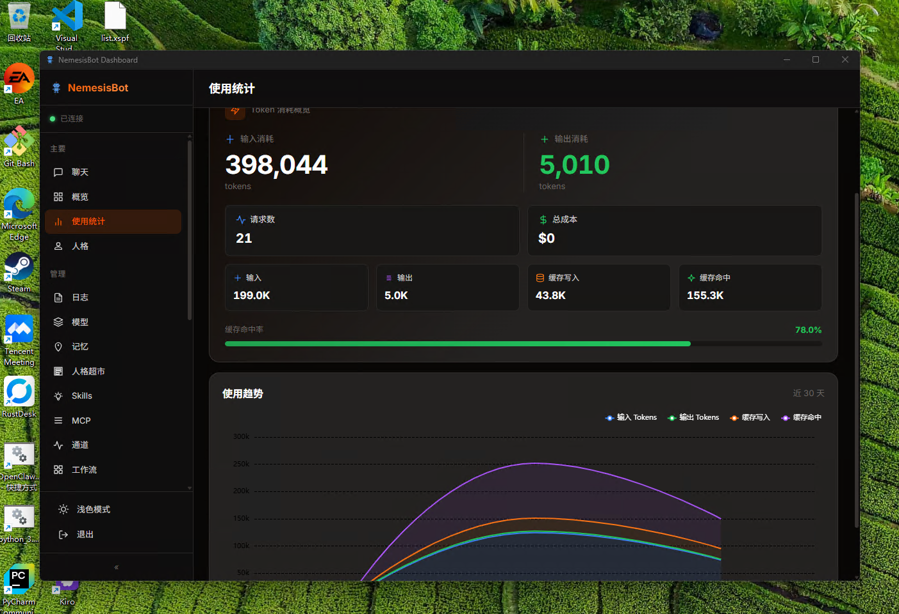
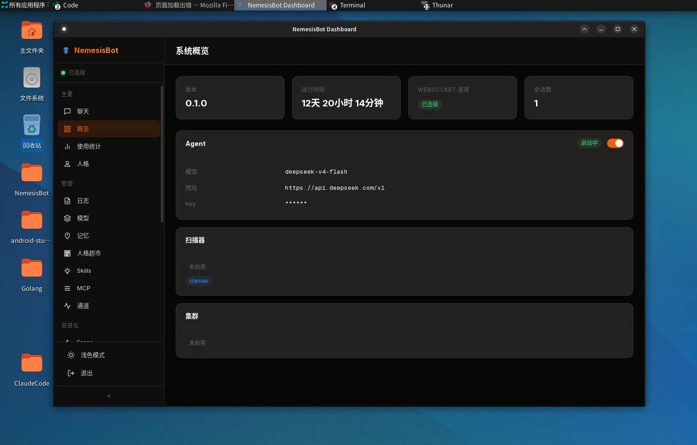
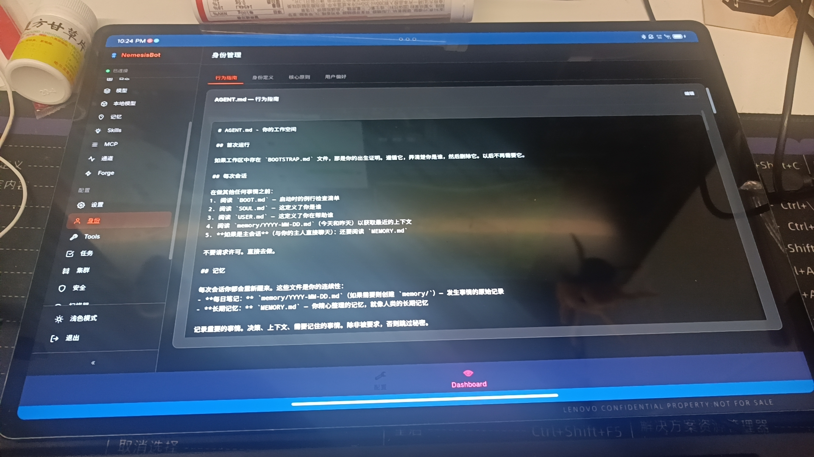
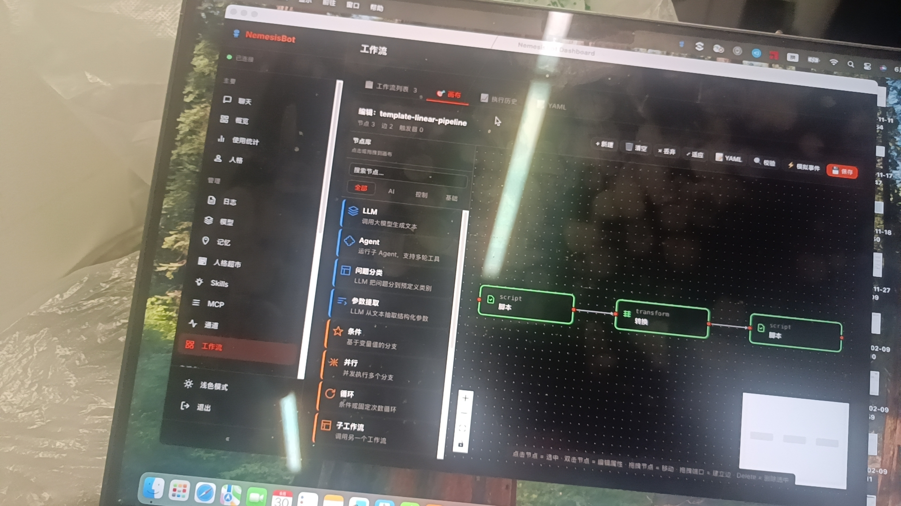

# NemesisBot (Rust)

<div align="center">

**安全第一的 AI 智能管家（Rust 版）**

[](https://www.gnu.org/licenses/agpl-3.0)
[](https://www.rust-lang.org/)
[](https://github.com/276793422/NemesisBot)

</div>

> （这句话是人写的）以下内容大部分都是AI胡掰，可信可不信，凡是AI说"稳定"的地方，可靠度都和投硬币差不多。

---

## 简介

NemesisBot 是一个轻量级、高安全性的个人 AI 助手与多入口编码代理：51 个核心 crate、26 种通讯通道、29,000+ 单元测试，支持 Windows / Linux / macOS / Android 四平台。

## 核心特性

- **安全体系（8+1 层）**：注入检测 → 命令守卫 → ABAC → 凭据扫描 → DLP → SSRF → 病毒扫描 → 审计链，八层管线在工具执行前按序拦截；第 9 层 Sandboxie 沙盒盒级物理隔离兜底。工作区隔离、危险操作审批卡、急停开关（CLI / 托盘 / Dashboard / WSAPI 四入口）。
- **执行体隔离**：LLM 高危操作（exec / 文件 / grep / git）可剥离到独立子进程，进 Sandboxie 盒全隔离（断网 + 降权，盒内写入手动审阅后提交）。Linux / macOS 提供用户态后端（landlock / bubblewrap / Seatbelt），另有 QEMU 桌面级 VM 后端。
- **分布式集群**：加密 UDP 自动发现 + QUIC 跨网组网（iroh 打洞，打不通回落自建中继）；异步 RPC + LLM 上下文续行快照；看板任务按专业职能与能力档位硬条件派发；Dashboard 六页签管理。
- **多入口编码代理**：headless `run`（NDJSON 事件流）、ACP 编辑器接入（Zed 等）、plan/build 双模式、审批卡与结构化提问、checkpoint / undo / redo / diff、LSP 诊断回灌、后台进程注册表、PTY 内嵌终端。安全体系在所有入口同源生效。
- **WASM 插件框架**：三方用 Rust 编译单个 `.wasm`（三平台通用），清单验签后热装载；四个 WIT world（tool / observer / loop-policy / panel）；fuel / 内存 / 墙钟限制 + 网络出口默认拒绝 + 秘密经 vault 注入；支持接管内置工具接口。
- **紫微系统**：对任意三方 Windows 程序（无源码、无接口）建立受控接管：注入探测 → 锚点定位 → 受管 profile → 远程调用；目标更新后锚点投票验证找回。
- **看板与自动化**：任务拆解 → 派发 → 执行 → 验收全自动流转，带预算保险丝、转人工停车场与审计回滚；任务档案一键导出。
- **连接器**：AI 原生行动代理的数据面（connector_find / invoke）+ 独占接管治理 + 纸面账本回执。
- **自学习（Forge）**：技能行为回归网、用户习惯画像、失败重放、受限微优化；持久化记忆（含 ONNX 本地嵌入）。
- **编译期裁剪**：所有子系统均为可选 cargo feature，menuconfig 风格 TUI 配置，Vue 前端同步裁剪；`iotsmall` profile 产物约 10MB（IoT / 低资源场景）。

## 多平台支持

**Windows**



**Linux**



**Android**



**MacOS**



---

## 快速开始

### 环境要求

- Rust 1.95.0（`rust-toolchain.toml` 钉死，rustup 自动安装）+ Cargo
- Windows 需 MSVC C++ 构建工具（链接器）
- Node.js LTS（构建 Vue 前端）；Go 可选（仅测试模拟器 TestAIServer 需要）

Windows 可双击 **`scripts\bootstrap-dev-env.bat`** 一键安装全套环境（MSVC + Rust + Node + Go，全程国内镜像源，幂等可重复运行）。

### 构建与初始化

```bash
git clone https://github.com/276793422/NemesisBot.git
cd NemesisBot

scripts\build-windows.bat        # Windows（版本注入 + 前端 + 插件）
scripts/build-linux.sh           # Linux / macOS
scripts\setup-android.bat && scripts\build-android.bat   # Android 交叉编译

nemesisbot onboard default       # 初始化配置与工作空间
nemesisbot model add --model zhipu/glm-4.7 --key YOUR_API_KEY --default
nemesisbot gateway               # 启动网关，浏览器打开 http://127.0.0.1:49000
```

功能裁剪：`scripts\customize.bat`（Windows）/ `customize.sh` 打开 menuconfig 风格 TUI，勾选后一键编译；`bash scripts/customize.sh iot` 直接构建最小 IoT 版。

模型能力分级：每个模型有 `model_tier` 档位（auto / mini / normal / big），决定工具供给面与校验重试预算；`nemesisbot model probe <name>` 用 8 题探针实测定档，运行中切换无需重启。

### 编码代理用法

```bash
nemesisbot run "修复 utils.rs 里的编译警告"      # headless 单任务，跑完即退
nemesisbot run --mode plan --workspace ./app "输出重构计划"   # 只读规划
nemesisbot run --format json - < task.txt        # stdin 读任务 + NDJSON 事件流
nemesisbot acp                                   # ACP 编辑器接入
```

## 项目结构

```
NemesisBot_Rust/
├── crates/                          # 51 个核心 crate
│   ├── nemesis-agent/               # Agent 核心（LLM 循环 + 工具执行）
│   ├── nemesis-security/            # 安全审计（8 层管线 + ABAC + 病毒扫描）
│   ├── nemesis-sandbox/             # Sandboxie 沙盒 / 用户态沙盒后端
│   ├── nemesis-cluster/             # 分布式集群（RPC + 续行快照 + QUIC 漫游桥）
│   ├── nemesis-plugins-wasm/        # WASM 插件宿主（wasmtime 壳独立构建）
│   ├── nemesis-plugin-sdk/          # WASM 插件三方 SDK
│   ├── nemesis-ziwei*/              # 紫微系统（门面 / profile / 分析引擎）
│   ├── nemesis-board/               # 看板（issue 数据模型 + SQLite）
│   ├── nemesis-connectors/          # 行动代理连接器
│   ├── nemesis-web/                 # Web API + WebSocket + SSE（55 个 Handler）
│   ├── nemesis-channels/            # 26 种通讯通道
│   └── ...                          # 完整清单见 Cargo.toml
├── plugins/                         # 运行时插件（plugin-ui / plugin-wasm / plugin-roaming / plugin-vm / plugin-onnx / wasm 示例）
├── nemesisbot/                      # 主程序入口（45 个命令模块）
├── web/                             # Vue 3 Dashboard 前端
├── test-tools/                      # 39 个测试工具（TestAIServer / integration-test / cluster-uat / agent-bench 等）
├── docs/                            # 文档（BUG / INFO / PLAN / REPORT）
└── scripts/                         # 构建 / 环境搭建 / 功能裁剪脚本
```

## 测试

```bash
cargo test --workspace               # 全部单元测试
cargo run -p integration-test        # CLI 集成测试（589 断言）
cargo run -p cluster-uat             # 集群 UAT（70+ 场景双节点端到端）
cargo build --release -p agent-bench && ./target/release/agent-bench.exe   # 自建基准 9 场景
```

质量基准（每项附复现命令）见 [docs/INFO/2026-09-24_公开基准.md](docs/INFO/2026-09-24_公开基准.md)：全 workspace 行覆盖 CI 硬门槛 84%、架构依赖矩阵 7 规则强制、agent-bench 9 场景 100% 通过（baseline 防倒退门禁）。

## CLI 速查

```
nemesisbot gateway          # 启动网关（Web UI + 托盘）
nemesisbot dashboard        # 打开 Dashboard
nemesisbot run              # headless 单任务（--mode plan / --format json）
nemesisbot acp              # ACP server（编辑器接入）
nemesisbot onboard          # 初始化配置
nemesisbot model            # 模型管理（add / probe / set-tier / prices）
nemesisbot cluster          # 集群管理（init / status / peers）
nemesisbot security         # 安全配置（approvals / scanner / session-allow）
nemesisbot sandbox          # 沙盒管理（install / start / pending / commit）
nemesisbot quic             # QUIC 中继（relay / status）
nemesisbot vm               # VM 环境自举（QEMU）
nemesisbot ziwei            # 紫微系统（向导 / invoke / verify / refresh）
nemesisbot connector        # 连接器查询（registry / receipts / ledger）
nemesisbot vault            # 凭据加密存储
nemesisbot plugin           # WASM 插件管理（install / enable / sign / trust）
nemesisbot selfupdate       # 版本自更新
nemesisbot mcp-serve        # 把 Bot 能力暴露为 stdio MCP server
nemesisbot issue            # 看板 issue 管理
nemesisbot autopilot        # 看板定时规则
nemesisbot eval             # 沙盒安全评估（prompt / skill / rules）
nemesisbot estop            # 急停开关
nemesisbot session          # 会话管理（分叉 / 恢复）
nemesisbot skills           # 技能管理（search / install）
nemesisbot persona          # 人格管理
nemesisbot forge            # 自学习管理
nemesisbot status           # 系统状态
```

> CLI 子命令随 cargo feature 条件编译：裁剪掉某子系统后对应子命令不存在。

## 文档

架构细节、安全层说明、开发计划与交付报告见 [`docs/`](docs/)（INFO / PLAN / REPORT / BUG 分目录）。

## 许可证（双授权）

NemesisBot 采用 **双授权（dual-license）** 模式：同一份代码，两种合法使用途径，由你按需选择。

### 1. 开源版 — GNU AGPL-3.0

- **免费**，包括商业使用、修改、分发。
- 但 AGPL 是强 copyleft：分发衍生品，**或把它作为网络服务对外提供**（AGPL §13），必须按 AGPL 公开你修改后的源代码。
- 详见 [LICENSE](LICENSE)（GNU AGPL-3.0 全文）。
- 适合：个人、开源项目、愿意回馈源代码的团队。

### 2. 商业版 — 商业授权

- 不想受 AGPL copyleft / §13 约束（要嵌入闭源产品、要做内部商用部署、不想公开修改）→ 申请商业授权。
- 详见 [COMMERCIAL_LICENSE.md](COMMERCIAL_LICENSE.md)（商业授权模板）。
- 适合：闭源商用、企业内部部署、SaaS 集成。

### 使用限制（附加条款）

**本人所有项目均禁止 联想(北京)有限公司 下 "Shrek Ding" 所属部门使用。**

本限制为版权持有人依 AGPL-3.0 第 7 条附加的补充条款，同时收录于 [LICENSE](LICENSE) 尾部「附加条款」节与 [COMMERCIAL_LICENSE.md](COMMERCIAL_LICENSE.md) 第 3 节，对两种授权路径均生效。

### 其他

- **第三方组件**：见 [THIRDPARTY.md](THIRDPARTY.md)，依赖树无 GPL/AGPL/LGPL 强 copyleft（仅 3 处文件级 MPL）；ClamAV 走网络协议、Sandboxie / QEMU 为运行时按需自装——均不打包、不传染。
- **贡献者**：外部 PR 须接受 [CLA.md](CLA.md)，以维持双授权能力。

---

<div align="center">

Made with Rust by NemesisBot contributors

</div>
